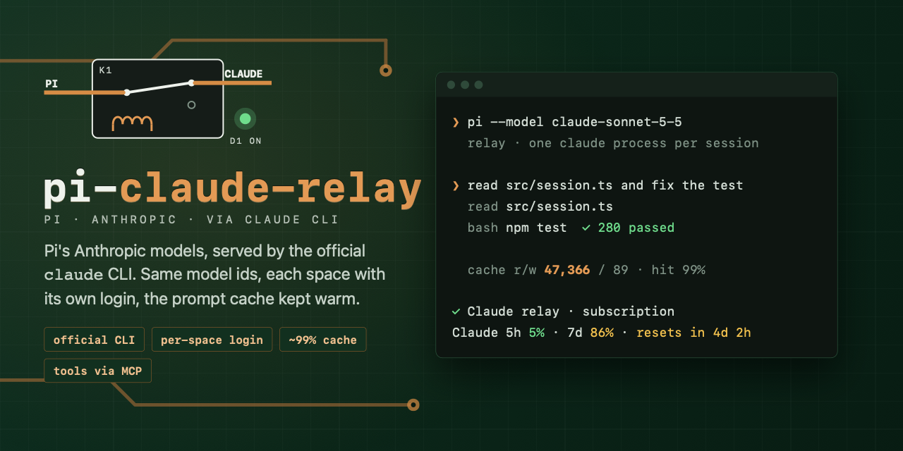

# ⎍ pi-claude-relay



A Pi (`@earendil-works/pi-coding-agent`) extension that relays Pi's built-in `anthropic` provider through the official Claude Code CLI (`claude -p`, stream-json). Every model request is made by the `claude` binary itself, with the Anthropic login of the Pi space it runs in; Pi's tools are served to Claude over a private, per-session local MCP server.

You keep choosing models exactly as before: `claude-opus-5-5`, `anthropic/claude-sonnet-5-5`, no relay prefix.

## Why

Pi's direct OAuth path to Anthropic can fail intermittently with:

```
Error: 429 {"type":"error","error":{"type":"rate_limit_error","message":"Error"}, ...}
```

while `claude -p` on the same account keeps working. The relay routes Pi's Anthropic traffic through the official client instead of imitating it: it never copies Claude Code headers or identity into Pi's own HTTP calls.

> **Account notice.** With a subscription login, the relay hands the Pi space's Anthropic OAuth token to the `claude` CLI so that a third-party harness (Pi) drives it. Anthropic's terms may restrict using a Claude subscription outside Claude Code and Claude.ai. Read them and decide for yourself; an API-key login is not affected.

## Requirements

- Node.js 22.18 or later.
- Pi (`@earendil-works/pi-coding-agent`).
- The `claude` CLI (Claude Code 2.1.330 or later) on `PATH`. You do not need to log in to it: the relay never uses `~/.claude` or its login.
- Each Pi space signed in to Anthropic with its own login (`/login` → Anthropic in that space). That login is the credential `claude` uses, so every space can use a different account. A space without an Anthropic login fails with a message telling you to run `/login`.

No environment variables are needed.

## Install

```sh
pi install npm:pi-claude-relay           # from npm
pi install /path/to/pi-claude-relay      # local checkout
pi -e /path/to/pi-claude-relay/extensions/claude-relay.ts   # one run only
```

Install it in every Pi space that should use it.

## Usage

```sh
pi --model claude-sonnet-5-5
pi --model anthropic/claude-opus-5-5:high
```

Thinking levels map to `claude --effort`, and Claude's thinking reaches Pi as summarized thinking blocks (`--thinking-display summarized`; `claude` streams them without text otherwise); tool calls, aborts, multi-turn sessions, and several Pi sessions at once work as with the direct provider. What does not carry over is listed under [Limitations](#limitations).

## Configuration

| Variable | Effect |
| --- | --- |
| `PI_CLAUDE_RELAY=off` (or `0`, `false`) | Disable the relay; Pi streams Anthropic directly again. |
| `PI_CLAUDE_RELAY_CLAUDE_BIN` | Path to the `claude` binary (default: `claude` on `PATH`). |
| `PI_CLAUDE_RELAY_DEBUG_LOG` | File to append one JSON line per settled turn to (see [Stats](#stats)). |

All are optional. Which login is used is never configured: it is the Anthropic login of the Pi space.

### Settings menu

`/claude-relay` with no arguments opens a settings menu in the style of Pi's `/settings` (Enter or Space toggles, Esc closes; the mouse wheel scrolls and a click selects, as in `/settings`). Each change is saved at once, per Pi space, exactly like the text commands below:

- **Usage warning pop-up** and **Usage limit pop-up** (see [Notifications](#notifications)),
- **Usage in status bar**, **Reset time in status bar**, **Reset time format** and **Status bar label** (see [Usage in the status bar](#usage-in-the-status-bar)),
- **Latency timing** (see [Latency timing](#latency-timing); its description shows the log file),
- a read-only **Stats** view, the same text as `/claude-relay stats` (see [Stats](#stats)).

Without an interactive terminal UI (print, JSON or RPC mode) `/claude-relay` with no arguments prints the usage line instead. The text subcommands (`notify`, `stats`, `timing`, `status`, `reset`, `label`) work everywhere and never open the menu. The menu loads `@earendil-works/pi-tui` from Pi at the moment it opens; if that fails the text behavior is used.

### Settings file

The menu and the text subcommands save to one file per Pi space, `<agent home>/claude-relay-settings.json` (written atomically with mode `0600`; a symlinked file is never written through). With every switch at its default it would read:

```json
{
  "notify": { "warning": true, "limit": true },
  "status": { "usage": true, "resetWhen": "always", "resetFormat": "full", "label": "claude" },
  "timing": false
}
```

| Key | Default | Set with | Effect |
| --- | --- | --- | --- |
| `notify.warning` | `true` | `/claude-relay notify warning on\|off` | Pop-up when you approach a usage limit |
| `notify.limit` | `true` | `/claude-relay notify limit on\|off` | Pop-up when a usage limit is reached |
| `status.usage` | `true` | `/claude-relay status on\|off` | Usage in the footer status; off shows the login line |
| `status.resetWhen` | `"always"` | `/claude-relay reset when always\|near\|never` | When the footer shows each usage window's reset time |
| `status.resetFormat` | `"full"` | `/claude-relay reset format full\|compact` | How the footer shows each usage window's reset time |
| `status.label` | `"claude"` | `/claude-relay label claude\|relay\|loop\|asterisk\|star\|keycap` | Prefix of the footer usage line: `Claude`, `⎍`, `🔁`, `✳️`, `✴️` or `*️⃣` |
| `timing` | `false` | `/claude-relay timing on\|off` | Latency timing log (`claude-relay-timing.jsonl`) |

The file is created on the first change; a missing file, an unreadable one, or a missing or invalid key means the default. Each change re-reads the file and writes only its own key, so other keys (and changes another Pi process made) are kept. Editing the file by hand works too; the relay reads it when Pi starts.

### Notifications

The relay shows two pop-ups when Claude's quota changes: a **warning** when you approach a limit (`Claude usage warning…`) and an error when the **limit** is reached (`Claude usage limit reached…`). Each can be switched off on its own with the `/claude-relay` command in Pi (both are on by default):

```
/claude-relay notify                 # show the current state
/claude-relay notify warning off     # mute the approaching-limit warning
/claude-relay notify limit off       # mute the limit-reached error
/claude-relay notify warning on      # turn it back on
```

The state is saved per Pi space in `<agent home>/claude-relay-settings.json` (`{ "notify": { "warning": true, "limit": true } }`); a missing or unreadable file means both on. Only the pop-ups are affected: the footer status and Pi's automatic retries stay the same.

### Usage in the status bar

After each response the footer shows your Claude usage and when each window resets (`Claude 5h 48% (resets in 52m) · 7d 73% (resets in 8h 12m)`). To hide it, turn off **Usage in status bar** in the `/claude-relay` menu or use the text command (on by default):

```
/claude-relay status         # show the current state
/claude-relay status off     # hide the usage; the footer shows the login line instead (✓ Claude relay · subscription)
/claude-relay status on      # show it again (the last usage seen at once, otherwise after the next response)
```

The change applies immediately, without restarting Pi. It is saved per Pi space in `<agent home>/claude-relay-settings.json` (`{ "status": { "usage": false } }`); a missing or unreadable file or field means on, and `notify`, `timing` and unknown keys are kept. Only the footer is affected: the usage warning and limit pop-ups (see [Notifications](#notifications)) and Pi's automatic retries stay the same.

Two settings shape each window's reset time: **Reset time in status bar** chooses *when* it shows, **Reset time format** *how*:

```
/claude-relay reset                  # show both (always, full)
/claude-relay reset when always      # Claude 5h 48% (resets in 52m) · 7d 73% (resets in 8h 12m)   (default)
/claude-relay reset when near        # Claude 5h 48% · 7d 73%, and near a limit: Claude 5h 91% (resets in 40m) · 7d 73%
/claude-relay reset when never       # Claude 5h 48% · 7d 73%, even near a limit
/claude-relay reset format full      # (resets in 52m)   (default)
/claude-relay reset format compact   # ↻52m
```

"Near a limit" is Claude's warning state (`allowed_warning`), the one that also brings the usage warning pop-up; with `near` only the window near its own limit shows its reset time (every window when Claude does not report a per-window status). Both apply at once and are saved as `{ "status": { "resetWhen": "near", "resetFormat": "compact" } }`; a missing or unknown value means the default. The reset times count from the last response and are recomputed whenever the footer is repainted (after a response or a settings change). A window without a reset time shows only its utilization. Near a limit the reset part is colored `warning`; when no window reports its own reset time, the overall one is shown instead (`Claude 5h 91% · resets in 40m`). A reached limit always reads `Claude limit reached · resets in …`, whatever these settings say. With **Usage in status bar** off they have no effect.

**Status bar label** in the menu (or `/claude-relay label`) chooses the prefix of the usage line:

```
/claude-relay label            # show the current choice
/claude-relay label claude     # Claude 5h 48% ↻52m · 7d 73% ↻8h 12m   (default)
/claude-relay label relay      # ⎍ 5h 48% ↻52m · 7d 73% ↻8h 12m   (the relay symbol)
/claude-relay label loop       # 🔁 5h 48% ↻52m · 7d 73% ↻8h 12m
/claude-relay label asterisk   # ✳️ 5h 48% ↻52m · 7d 73% ↻8h 12m
/claude-relay label star       # ✴️ 5h 48% ↻52m · 7d 73% ↻8h 12m
/claude-relay label keycap     # *️⃣ 5h 48% ↻52m · 7d 73% ↻8h 12m
```

It applies to every state of the usage line (`⎍ limit reached · resets in …` too), at once, and is saved as `{ "status": { "label": "relay" } }`; a missing or unknown value means `claude`. The login line and the pop-ups keep saying Claude.

### Stats

`/claude-relay stats` shows how well the relay keeps Anthropic's prompt cache warm in this Pi process (counters start at zero when Pi starts) and, while [latency timing](#latency-timing) is on, where the time of a request goes:

```
Claude relay stats: 12 turns · cache hit 91%
process starts: 1 · restarts: 2 (abort 1, model 1) · resumed: 2
cache warm requests answered locally: 3 · one-off requests: 1
latency, last 12 requests · median / p90
first event: 750 / 2200 ms (n=12)
first thinking: 950 / 2400 ms (n=9)
first text or tool call: 1200 / 2600 ms (n=12)
total: 12130 / 41030 ms (n=12)
output rate: 74 tok/s median, 52 slowest 10% (n=12)
```

With timing off the last block is one line, `latency timing: off (/claude-relay timing on records it)`; with timing on and no timed request yet, `latency timing: on, no timed requests yet`.

- **cache hit** = cache-read tokens ÷ (input + cache-read + cache-write tokens), over the turns of your Pi sessions.
- **process starts** are first `claude` processes of a Pi session; **restarts** replaced a process that held a warm cache, with the reason: `model`, `system-prompt`, `tools`, `effort`, `credential`, `history` (compaction, branch switch, edited history), `missing-tool-call`, `other`, or a process lost outside the planner: `abort`, `error`, `exit`.
- **resumed** (shown only when above zero) counts the restarts that continued `claude`'s own session with `--resume` instead of replaying a flattened transcript (see [How it works](#how-it-works)); it is a subset of the restarts.
- **cache warm requests** are Pi's idle cache-warming requests, answered locally without reaching `claude`; **one-off requests** are turns of throwaway sessions (compaction and summaries), which are kept out of the other figures.
- **latency** summarizes the last 500 timed requests of this Pi process (normal turns that finished without an error): count, median and p90 of the first line, first thinking, first text or tool call, and the total.
- **output rate** is output tokens per second from the first generated token (thinking, text or tool call) to the end of the message, as the median and the slowest 10%. Unlike a rate over the whole request, it leaves out starting `claude`, the time to the first token and Pi's tool runs; requests without output tokens or a generated token are left out.

Set `PI_CLAUDE_RELAY_DEBUG_LOG=/path/to/file` to also append one JSON line per settled turn (`t`, `session` = first 8 hex of the sha256 of the Pi session id, `plan`, `reason`, `changed`, `stopReason`, `usage`, `systemPromptHash`, `toolsHash`, `messages`). `reason` is the first cause of a restart, as in `stats`; for a config change `changed` lists every field that changed (`["system-prompt", "tools"]`). Pi lists the active tools in the system prompt, so a tool set that changes mid-session (a tool registering after the first turn, for example) usually shows as `system-prompt` with `tools` in `changed`. The file is created with mode `0600` and never contains prompt text, tool arguments, credentials or the MCP URL; write errors are ignored.

### Latency timing

Pi's session log records only the total duration of a request. To see where the time goes (starting `claude`, time to the first token), switch on timing; it is **off by default**:

```
/claude-relay timing          # state and log file
/claude-relay timing on       # start recording
/claude-relay timing off      # stop
```

The switch is saved per Pi space in `<agent home>/claude-relay-settings.json` (`{ "timing": true }`; a missing or unreadable file or field means off, and `notify` is kept). While it is on, each settled request appends **one JSON line** to `<agent home>/claude-relay-timing.jsonl` (created with mode `0600`). Marks are milliseconds since the request started, taken with a monotonic clock:

| Field | Meaning |
| --- | --- |
| `spawn` | a `claude` process was started or restarted for this request (absent when the live one was reused); `plan` and `reason` say which, with the same restart reasons as `stats`; `changed` lists every changed config field, as in the debug log |
| `firstLine` | first line `claude` wrote for the request |
| `messageStart` | the response started (`message_start`) |
| `firstThinking`, `firstText`, `firstTool` | first thinking delta, first text delta, first tool call |
| `stop`, `settle` | the message ended; the request was finished |

plus `t` (wall-clock ms), `session` (first 8 hex of the sha256 of the Pi session id), `model`, `stopReason` and `output` (output tokens); `throwaway` marks one-off requests (compaction, summaries). The file never contains prompt text, tool names or arguments, credentials, URLs or paths.

`/claude-relay stats` shows the summary of the timed requests (see [Stats](#stats)).

There is no measurable cost: when it is off, a request pays one boolean check and nothing per streamed event. When it is on, the marks live in memory and the line is written after the request settled, with an asynchronous append that the turn never waits for; write errors are ignored.

## How it works

- **One `claude` process per Pi session**, kept alive across turns and keyed by Pi's session id, so parallel sessions and subagents never share state. Requests for a session id Pi never announced (compaction, summaries, other one-off calls) run in a throwaway process that is closed when the request ends.
- **Per-space login.** Pi resolves the space's Anthropic credential and the relay hands it to `claude` for that process only: a subscription (OAuth) token as `CLAUDE_CODE_OAUTH_TOKEN`, an API key as `ANTHROPIC_API_KEY`. Every inherited `ANTHROPIC_*`, `CLAUDE_CODE_*` and `CLAUDE_CONFIG_DIR` is dropped, and `claude` keeps its state in `<agent home>/claude-relay` (private, `0700`) inside the space. A changed credential (token refresh, other login) restarts `claude` (see *Restarts keep the cache* below).
- **Pi tools through MCP.** Each session hosts an MCP server on `127.0.0.1` with a random port and path token. When Claude calls a tool, the relay hands the call to Pi and parks the MCP request until Pi returns the result on its next request; Claude then continues in the same process.
- **Long tool calls.** A Pi tool can run for a long time without output (a review, a CI run, a subagent). `claude` aborts an HTTP MCP call that sends nothing for 5 minutes, so the relay gives its MCP server a per-call `timeout` of 24 hours and turns that idle timer off (`CLAUDE_CODE_MCP_TOOL_IDLE_TIMEOUT=0`). An inherited `CLAUDE_AUTO_BACKGROUND_TASKS` is dropped so that `claude` never moves a parked Pi call to the background. If `claude` still gives up on a parked call (it closes the request, sends `notifications/cancelled`, or ends its turn while Pi still runs the tool), the relay stops that `claude` at once: its session no longer matches Pi's history. When Pi delivers the result, the relay starts a new process with a transcript replay (restart reason `missing-tool-call`) instead of waiting forever. A request that was already waiting on the call restarts within the same request, or fails with a message if part of its answer had already reached Pi.
- **Isolation.** `claude` runs with no built-in tools (`--tools ""`), `--strict-mcp-config`, `--setting-sources ""`, and Pi's system prompt, so `CLAUDE.md`, hooks, plugins, and user settings stay out. The system prompt and MCP config are passed through `0600` files in a private temp directory, never on the command line.
- **Abort interrupts instead of killing.** When you abort a turn, Pi's turn ends at once, parked tool calls fail with an aborted error, and the relay sends `claude` an `interrupt` control request. The process stays alive with its prompt cache; your next message waits (up to 5 s) for `claude` to confirm the interrupted turn and is then a plain message on the same process. If `claude` does not confirm in time it is killed and restarted as below.
- **Several new messages, one line.** Pi turns each extension notice into a user message of its own, and background work often adds two at once (a result and its wake-up notice). When only user messages follow a finished turn or the tool results, the relay sends them to the live `claude` process together as one user line, so the session and its prompt cache continue instead of restarting.
- **Restarts keep the cache.** The first `claude` process of a Pi session is started with `--session-id <uuid>` and session persistence on, and the relay tracks the session id `claude` reports. When a process has to be replaced (credential refresh, effort, tool-set or model change, a crash, an unconfirmed interrupt) and Pi's history has not diverged from what `claude` already has, the new process is started with `--resume <session id>` and receives only the new message: Anthropic's prompt cache and the structured history survive. A resumed session whose turn fails is not resumed again: the next attempt replays the transcript. The relay falls back to replaying a flattened transcript in a fresh session only when the history diverged (compaction, branch switch, edited history), a tool call was pending, no session id is known, the system prompt changed (`claude` keeps the system prompt a session started with, so a changed one cannot be applied on resume), or the resumed process fails to start (one fallback, in the same request). One-off requests (compaction and summaries) never persist or resume a session.
- **Pi's transcript is the source of truth.** The relay never reads Claude Code session files; they only let a replaced process pick up where the previous one stopped.
- **Footer status.** From session start the footer shows the relay and the space's login (`✓ Claude relay · subscription`, `✓ Claude relay · API key`, or `✗ Claude relay · no Anthropic login in this space (/login)`). Footer colors follow Pi's theme: the `✓` lines stay uncolored, the `✗` line is `error`; when no theme is available the footer is plain text. Hosts that draw extension statuses in their own panel (Gentle Shell's INTEGRATIONS panel, for example) may show these lines without the colors.
- **Rate limits.** Claude's `rate_limit_event` is exposed to Pi as `anthropic-ratelimit-unified-*` response headers, shown in the footer unless switched off with `/claude-relay status off` (`Claude 5h 16% (resets in 52m) · 7d 15% (resets in 8h 12m)`, the reset times shaped by `/claude-relay reset when|format`, each window colored by its utilization like Pi's own context-usage footer: `error` above 90 %, `warning` above 70 %, otherwise `success`; `Claude limit reached · …` is `error`, and the reset part of a warning is `warning`), and limit errors are worded so Pi's retry logic recognizes them: a transient rate limit (`429 rate limit: …`) is retried with Pi's backoff, while an exhausted usage window (`429 quota exceeded: You've hit your 5-hour limit · …`, or any error after a `rejected` rate-limit event for the same request) fails at once instead of being retried until the window resets.
- **Tool schemas.** Top-level `anyOf`/`oneOf`/`allOf` tool schemas are flattened into one object schema that Claude accepts.

## Limitations

- Request options Pi's direct provider honors are ignored, because `claude` decides them: `maxTokens`, `temperature`, custom headers, `cacheRetention`, and a custom Anthropic `baseUrl` or gateway (requests always go to Anthropic).
- Cost is computed from the tokens `claude` reports with Pi's own rates for the model (1 h cache writes included), so Pi's footer and stats show it. With a subscription login it is the API-price equivalent, not what you pay; tokens `claude` adds that it does not report are not counted.
- A flattened transcript replay (see [How it works](#how-it-works)) loses the prompt cache of the conversation and replaces images in the history with `[image]`. Plain Pi keeps its system prompt stable, so this happens only after compaction, a branch switch or edited history; an extension that changes the system prompt during a session (for example once after the first turn) adds one replay per change.
- While a Pi session lives, `claude`'s transcript files stay on disk inside the space, in `<agent home>/claude-relay/projects/<project>/<session id>.jsonl` (they hold the conversation, including the system prompt). They are deleted when the Pi session closes and when Pi exits; a Pi that crashes or is killed leaves them behind, and the relay removes transcripts untouched for 7 days the next time it starts. Other state `claude` keeps in that folder (settings caches, policy files) is not removed.
- Requires the `claude` CLI; usage is billed to the space's Anthropic login (subscription plan or API key), like any Claude Code use.
- Thinking text is the summary the API returns for `--thinking-display summarized`, not the full reasoning.
- In single-shot print mode (`pi -p`) Pi exits before Claude's post-message rate-limit event, so the footer only updates in interactive and multi-turn sessions.

## Alternatives

Other Pi packages also bring Claude to Pi; they take different routes:

- [`pi-claude-bridge`](https://www.npmjs.com/package/pi-claude-bridge) drives Claude through the Claude Agent SDK as a separate provider (models carry the provider prefix), starts a query per request and resumes Claude Code's on-disk sessions, and uses the shared `~/.claude` login and settings.
- [`pi-claude-oauth-adapter`](https://www.npmjs.com/package/pi-claude-oauth-adapter) keeps Pi calling the Anthropic API directly with a subscription token, presenting the requests as Claude Code.

`pi-claude-oauth-adapter` and pi-claude-relay both take over Pi's `anthropic` provider, so install only one of them in a Pi space: with both, whichever registers last handles every request.

pi-claude-relay differs in that the official `claude` CLI makes every request (no Claude Code identity in Pi's own calls), Pi's built-in `anthropic` provider and model ids stay as they are, each Pi space uses its own login with no environment variables, one long-lived process per Pi session keeps the prompt cache warm, and Pi's transcript stays the source of truth.

## Development

```sh
npm test
```

## License

[MIT](LICENSE)
